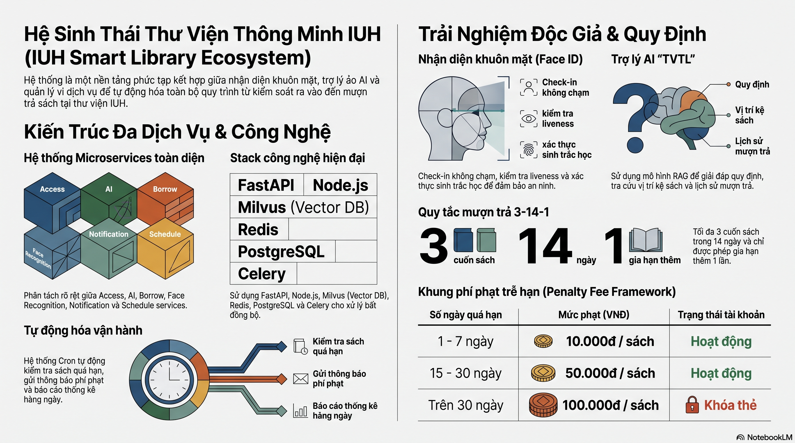

# Hệ Sinh Thái Thư Viện Thông Minh — Backend

Backend microservices cho hệ thống thư viện thông minh tích hợp nhận diện khuôn mặt, AI chatbot, mượn/trả sách tự động, kiểm soát ra vào và quản lý nhân sự.



## Architecture

```text
Backend/
├── api-gateway/                 # Express API Gateway — routes /api/* đến services
├── user-service/                # Node.js — người dùng, JWT auth, phân quyền
├── borrow-service/              # Node.js — mượn/trả sách, danh mục, waitlist
├── access-service/              # Node.js — access logs, trạng thái, SSE/WebSocket
├── schedule-service/            # Node.js — lịch làm việc, ca, chấm công
├── ai-service/                  # Node.js — AI chatbot, RAG, ChromaDB
├── notification-service/        # Node.js — push notification, WebSocket realtime
├── automation-service/          # Node.js — cron job, quá hạn, thông báo tự động
├── face-recognition-service/    # FastAPI + Celery — nhận diện khuôn mặt, camera
├── shared/                      # Shared utilities, auth helpers, types
├── docker-compose.yml           # Khởi động tất cả services
└── .env.example
```

## Services

| Service | Container | Port | Mô tả |
| --- | --- | --- | --- |
| postgres | backend-postgres-1 | 5432 | PostgreSQL — cơ sở dữ liệu chính |
| redis | backend-redis-1 | 6379 | Redis — cache, Celery broker, pub/sub |
| rabbitmq | rabbitmq | 15672 | RabbitMQ — async messaging giữa services |
| minio | backend-minio-1 | 9000/9001 | MinIO — lưu trữ ảnh khuôn mặt, evidence |
| milvus | backend-milvus-1 | 19530/9091 | Milvus — vector database cho face embedding |
| chromadb | chromadb | 8000 | ChromaDB — knowledge base cho AI |
| face-recognition-api | face-recognition-api | 8000 | FastAPI — face, camera, kiosk APIs |
| worker | backend-worker-* | — | Celery worker — xử lý ảnh bất đồng bộ |
| gateway | api-gateway | 80 | Express API Gateway — entry point |
| user-service | user-service | 3001 | Người dùng, auth, JWT, phân quyền |
| borrow-service | borrow-service | 8000 | Mượn/trả sách, danh mục, waitlist |
| access-service | access-service | 3003 | Access logs, trạng thái, SSE/WS |
| schedule-service | schedule-service | 3002 | Lịch làm việc, ca, chấm công, geofence |
| ai-service | ai-service | 3004 | AI chatbot, RAG, ChromaDB, OpenRouter/NVIDIA |
| notification-service | notification-service | 3006 | Push notification, WebSocket realtime |
| automation-service | automation-service | 3007 | Cron job, quá hạn, thông báo tự động |

## Clone và chạy

1. Copy file environment:

```powershell
cd D:\IUH\DOAN_TOTNGHIEP\Backend
copy .env.example .env
copy api-gateway\.env.example api-gateway\.env
copy user-service\.env.example user-service\.env
```

2. Build và start tất cả services:

```powershell
docker compose up -d --build
```

3. Kiểm tra:

```powershell
docker compose ps
curl http://localhost/healthz
curl http://localhost/openapi.json
```

Docker build các TypeScript services trong quá trình image build. Để chạy local dev ngoài Docker, chạy `npm install && npm run build` trong từng service.

## Endpoint

| Service | URL | Ghi chú |
| --- | --- | --- |
| API Gateway | http://localhost | Entry point công cộng |
| API Docs | http://localhost/docs | OpenAPI docs (face-recognition) |
| OpenAPI JSON | http://localhost/openapi.json | OpenAPI schema |
| MinIO Console | http://localhost:9001 | `minioadmin / minioadmin` |
| RabbitMQ UI | http://localhost:15672 | `guest / guest` |

## Smoke tests

- `GET /healthz`
- `GET /openapi.json`
- `POST /auth/login`
- `POST /api/auth/face-login`
- `POST /api/face/enroll-batch`
- `GET /api/tasks/{job_id}`
- `GET /api/camera/status`
- `GET /api/access/stats`
- `GET /api/borrow/books`

## Quy tắc luồng ra vào

- `POST /api/auth/face-login` chỉ xác thực và trả token. Không cập nhật `users.current_status`, không ghi access log.
- Camera entry chỉ ghi `entry`. Camera exit chỉ ghi `exit`.
- Kiosk có thể auto-toggle entry/exit dựa trên trạng thái hiện tại.
- `user-service` sở hữu `users`.
- `access-service` sở hữu access logs, trạng thái bạn đọc, SSE và WebSocket.
- Face worker ghi nhận access qua `POST /internal/access/recognition-events`.

## Lỗi thường gặp

### Build hoặc clone không chạy được

```powershell
copy .env.example .env
docker compose up -d --build
```

Kiểm tra TypeScript local:

```powershell
cd api-gateway
npm install
npm run build

cd ..\user-service
npm install
npm run build
```

### Cổng 80 đã được dùng

```powershell
netstat -ano | findstr :80
taskkill /PID <pid> /F
```

### Worker cứ restart

Đợi PostgreSQL, Redis, MinIO, Milvus healthy rồi restart worker:

```powershell
docker compose ps
docker compose logs worker
docker compose restart worker
```

### Milvus unhealthy

```powershell
docker compose down
docker volume prune
docker compose up -d --build
```

## Chạy test

```powershell
cd api-gateway
npm install && npm run build

cd ..\user-service
npm install && npm run build

cd ..\borrow-service
npm install && npm run build

cd ..\access-service
npm install && npm run build

cd ..\schedule-service
npm install && npm run build

cd ..
node scripts\check-service-boundaries.js

cd ..\face-recognition-service
python -m py_compile worker\tasks.py

cd ..\borrow-service
pytest
```
